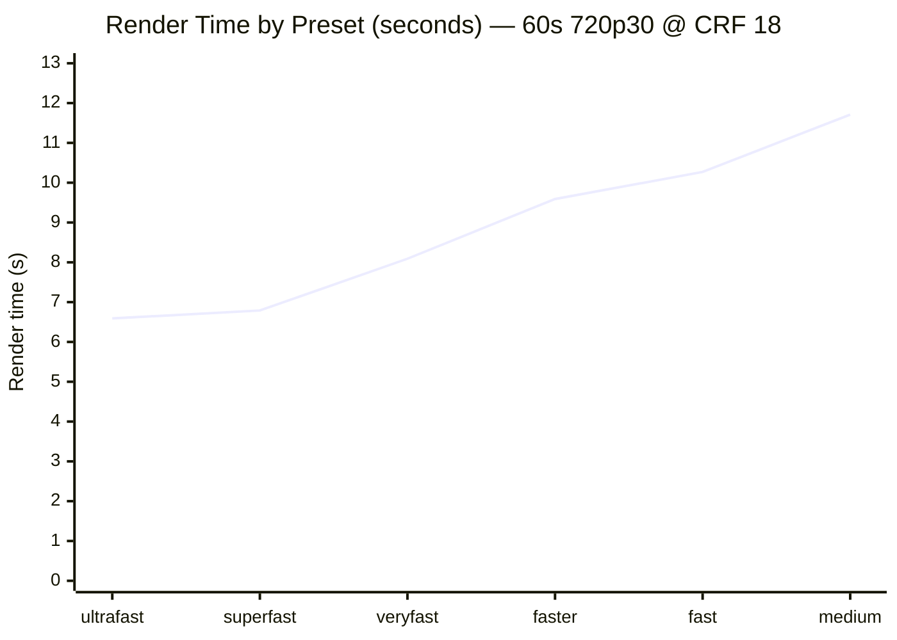
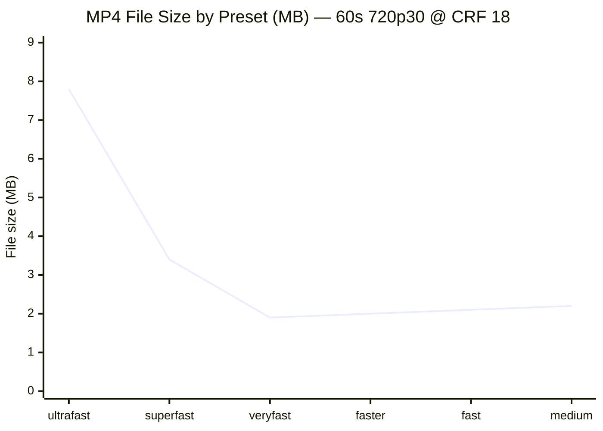

<p align="center">
  
</p>

# rustren

Browserless 2.5D video render engine in Rust — built to be **fast** and **predictable for AI-generated video**.

> **Try Online (Zero Install):**
> - **Web Studio (PWA, BYOK AI Director + Browser WebM/PNG + MP4 via API):** https://nvm.web.id/rustren/studio/
> - **Hosted Render API (Experimental, AI-discoverable):** https://nvm.web.id/rustren/api/ ([`llms.txt`](https://nvm.web.id/rustren/llms.txt) · [Request API token](https://nvm.web.id/contact/))
> - **Project Homepage:** https://nvm.web.id/rustren/

```
AI generates (JSON / HTML) → Compiler parses to IR → Schema validates → Previews (snapshot / layout) → Renderer executes → MP4 out
```

`rustren` compiles declarative **JSON** or **HTML** scenes into an MP4 video or PNG frame snapshots without spawning a headless browser, DOM, or Chromium engine. Every stage of the pipeline is explicit, inspectable, and deterministic.

## Teaser — Rustren Showreel (60s, 30fps, 16 Scenes)
**100% Rust, no browser. `JSON / HTML in → MP4 out.`**

- **Source JSON:** [examples/showreel.json](examples/showreel.json) (`93` root layers, `16` scenes including 2.5D spatial cards, isometric bento, card flips, surface shaders, and finale)
- **Output MP4:** [assets/showreel.mp4](assets/showreel.mp4) (`1280×720 @ 30fps`, `60.0s` / `1,800` frames, default `--crf 18 --preset medium`)
- **Hardware:** `8 vCPU` Intel Xeon E5-2630 v4 @ 2.20GHz, `15 GiB` RAM (CPU-only, no GPU)

| Metric | Measured (`--preset medium --crf 18`) |
| :--- | :--- |
| **Render Time (Wall Clock)** | `11.71s` *(or `8.09s` on `veryfast`, `6.59s` on `ultrafast`)* |
| **Average Speed** | `153.7 fps` (`5.12×` real-time) |
| **MP4 File Size** | `2.2 MB` |
| **Duration / Frame** | `6.51 ms / frame` |
| **Frame Dedup Cache Hit** | `66.7%` (`1,200 hits / 600 misses`) |

<details>
<summary><strong>Preset Scaling Curve (<code>--crf 18</code>, 60s / 1,800 frames)</strong></summary>

<p align="center">
  <strong>Render time by preset</strong> (seconds, lower = faster)
</p>



<p align="center">
  <strong>MP4 file size by preset</strong> (MB, lower = smaller)
</p>



> Measured on `examples/showreel.json`, one run per preset, so differences of a few percent are within run-to-run noise. Read the two charts together: `veryfast` is the best trade-off here — it renders faster than `faster`/`fast`/`medium` **and** produces the smallest file (`1.9 MB`), while `ultrafast`/`superfast` render slightly faster but at a much larger file size.

| Preset | Render Time | Average Speed | MP4 File Size |
| :--- | :--- | :--- | :--- |
| `ultrafast` | `6.59s` | `273.1 fps` (`9.10×`) | `7.8 MB` |
| `superfast` | `6.79s` | `265.1 fps` (`8.84×`) | `3.4 MB` |
| `veryfast` | `8.09s` | `222.5 fps` (`7.42×`) | `1.9 MB` |
| `faster` | `9.59s` | `187.7 fps` (`6.26×`) | `2.0 MB` |
| `fast` | `10.27s` | `175.3 fps` (`5.84×`) | `2.1 MB` |
| `medium` *(default)* | `11.71s` | `153.7 fps` (`5.12×`) | `2.2 MB` |

</details>

https://github.com/user-attachments/assets/7089ed1a-c188-4d1b-9f3a-ac08d2ca9e64

> Full 60s `1280×720 @ 30fps` MP4: [assets/showreel.mp4](assets/showreel.mp4)

## Zero-Encode Preview (`snapshot` & `layout`) — AI One-Shot Loop
Unlike traditional video pipelines that force you to encode a full MP4 just to check alignment, `rustren` lets AI agents and developers inspect any timestamp in milliseconds:


```bash
# Render 16 keyframes across the 60s showreel into one 4x4 contact sheet (~0.95s, no FFmpeg)
rustren snapshot examples/showreel.json -t 1.5,3.3,5.5,7.0,8.8,11.0,14.5,18.5,23.5,28.0,32.5,37.5,42.0,47.0,51.5,57.5 --sheet --cols 4 -o assets/showreel_sheet.png

# Or inspect exact computed bounding boxes & measured text widths as JSON
rustren layout examples/showreel.json -t 14.5

# Watch mode: re-validate and re-render the active frame on every save (~12ms/frame)
rustren watch examples/showreel.json -t 1.5 -o preview.png

# Visual regression test: compare two scenes at timestamp t and fail if MAE > threshold
rustren diff baseline.json current.json -t 1.5 --threshold 0.01 --out diff.png
```

## Architecture & Why Browserless?
- **Pure-Rust Raster Pipeline**: Combines `tiny-skia` (2D vector/compositing), `cosmic-text` (text shaping & rich spans), `resvg` (SVG rendering), `taffy` (Flexbox layout), and `rayon` (parallel frame rendering), piped directly to `ffmpeg` for H.264 MP4 output.
- **Built-in Render Caches**: Static background prefix snapshotting, thread-local SVG raster/tree caches, and blurred-layer caching avoid re-computing unchanged pixels across frames.
- **Deterministic & Inspectable**: Same JSON produces identical frames across runs, with `snapshot` PNG previews and `layout` bounding-box inspection built into the CLI.

## Multi-Format Input (JSON & HTML)
`rustren` features an Intermediate Representation (IR) compiler architecture supporting multiple declarative input formats:
- **JSON (`.json`)**: Raw declarative scene schema (compact for AI generation and programmatic pipelines).
- **HTML (`.html`, `.htm`)**: Clean declarative markup with tags like `<scene>`, `<container>`, `<rect>`, `<circle>`, `<text>`, `<animate>`, and `<profiles>`.

```bash
# Render from JSON or HTML interchangeably:
rustren render examples/showreel.json -o showreel.mp4
rustren render examples/cuboid_carousel.html -o cuboid.mp4
```

## Key Features
- **Multi-Format Compiler Architecture**: Extensible compiler trait with automatic format detection (`.json`, `.html`).
- **Capability Registry & Version Gate**: `rustren capabilities` publishes renderer version (`1.1`), schema version (`1.1`), and supported features.
- **Declarative Layout & Visuals**: Flexbox (`taffy`), `container` (`clip`, `cascade_opacity`, `stagger_secs`), `rect`, `circle`, `text` (rich text `spans` with per-span `font_size`, `letter_spacing`, `outline`, `gradient`, RTL/BiDi `direction: "auto" | "ltr" | "rtl"`, dynamic alignment `text_align: "start" | "end"`, `dynamic` typewriter/counter/timecode), `waveform` visualizer, `lottie` animation, `svg`, `image` & `video` (`fit: "fill" | "cover" | "contain"`), `anchor`, `skew_x`/`skew_y`, linear/radial multi-stop `gradient`, plus `blur`, `shadow`, and `blend_mode`.
- **Composition Profiles**: Define multi-format variants (`profiles: { "portrait": { ... }, "square": { ... } }`) in one scene and render via `--composition <name>` across all CLI commands (`render`, `validate`, `snapshot`, `layout`, `watch`, and `/jobs` API).
- **Timeline & Sequencing**: Global `start_sec`/`end_sec`, `duration_secs`, `timeline: "local"`, and `timeline: "series"` with `overlap_secs`.
- **Media & A/V Sync**: `video` layer with `trim_start_sec`, `trim_end_sec`, `playback_rate`, `volume`, and `muted` synced to FFmpeg; multi-track `audio` with `fade_in_secs`, `fade_out_secs`, and volume ducking keyframes.
- **Advanced Motion**: `keyframes[]` multi-stop timelines, mathematical per-frame `expr` with precompiled AST cache and math helpers (`clamp`, `lerp`, `smoothstep`, `abs`, `min`, `max`), custom `spring` (`stiffness`, `damping`, `mass`), `repeat` & `yoyo`, `cubic_bezier` + Penner easings, color interpolation (`color`, `border_color`), and path/stroke animation (`path_progress`, `stroke_dashoffset`).
- **AI Authoring & Debugging Tools**: Instant single-frame / contact-sheet `snapshot`, computed bounding-box `layout` inspection, smart `validate` linting, and `--profile` performance breakdown.

## Prerequisites & Installation
- **`ffmpeg`** (and `ffprobe` for `video` layers) available in `PATH`
- **Automatic GPU Hardware Encoding**: Probes for a working GPU H.264 encoder (`h264_nvenc`, `h264_videotoolbox`, `h264_qsv`) by default and falls back cleanly to `libx264` CPU encoding when unavailable. Override with `RUSTREN_HW_ENCODER=off` (force CPU) or an explicit encoder name.

### Quick Install (Prebuilt Binary — No Rust Required)
Always installs the latest GitHub Release automatically:

**Linux (`x86_64`) / macOS (`Apple Silicon`):**
```bash
curl -fsSL https://raw.githubusercontent.com/sharriffajar/rustren/main/scripts/install.sh | sh
```

**Windows (PowerShell):**
```powershell
irm https://raw.githubusercontent.com/sharriffajar/rustren/main/scripts/install.ps1 | iex
```

### Install via Cargo (`crates.io`)
```bash
cargo install rustren
```

### Build from Source
```bash
git clone https://github.com/sharriffajar/rustren.git
cd rustren
cargo build --release
# Binary will be at ./target/release/rustren
```

## Quick Start
Save a minimal scene as `hello.json`:
```json
{
  "schema_version": "1.1",
  "canvas": { "width": 1280, "height": 720, "fps": 30, "duration_secs": 3.0, "background": "#0F172A" },
  "layers": [
    {
      "type": "rect",
      "x": 640,
      "y": 360,
      "width": 520,
      "height": 180,
      "radius": 24,
      "color": "#2D4AF2",
      "anchor": "center",
      "skew_x": -12,
      "animations": [
        { "property": "scale", "from": 0.8, "to": 1.0, "start_sec": 0.0, "end_sec": 0.6, "easing": "spring" }
      ]
    },
    {
      "type": "text",
      "x": 640,
      "y": 360,
      "font_size": 64,
      "font_weight": "bold",
      "color": "#FFFFFF",
      "anchor": "center",
      "dynamic": { "mode": "typewriter", "text": "rustren", "start_sec": 0.1, "end_sec": 0.9 }
    }
  ]
}
```

Validate, preview a frame, and render to MP4:
```bash
rustren validate hello.json
rustren snapshot hello.json -t 1.0 -o preview.png
rustren render hello.json -o hello.mp4
```

## CLI Commands
```bash
# Inspect renderer capabilities (JSON)
rustren capabilities

# Validate and lint a scene JSON before rendering (add --strict-determinism for CI)
rustren validate scene.json
rustren validate scene.json --strict-determinism
# Machine-readable result on stdout: {valid, warnings:[{code,path,message,fix,...}]}
rustren validate scene.json --error-format json

# Render a single frame or contact sheet to PNG (no FFmpeg encode)
rustren snapshot scene.json -t 1.5 -o frame.png
rustren snapshot scene.json -t 1.5,5.6,14.5 --sheet -o sheet.png

# Inspect computed layer bounding boxes & measured text dimensions
rustren layout scene.json -t 5.0

# Render scene JSON to MP4 (default: --crf 18 --preset medium)
rustren render scene.json -o output.mp4
# Machine-readable summary on stdout, progress on stderr
rustren render scene.json -o output.mp4 --error-format json

# Render with custom encoding options and per-layer/cache profiling
rustren render scene.json -o output.mp4 --crf 20 --preset fast --profile

# Start the HTTP render API server
rustren serve --port 8080

# Start the MCP stdio server (AI agents: edit, validate, snapshot, diff, render)
rustren mcp scene.json
```

## MCP Server for AI Agents (`rustren mcp`)
`rustren mcp scene.json` speaks JSON-RPC 2.0 over stdio, so an agent can close the
author → measure → repair loop without shelling out. Available in every build
(no `pro` feature gate).

| Tool | Purpose |
|---|---|
| `get_scene_summary`, `add_layer`, `remove_layer`, `add_animation` | Inspect/edit; edits are written back to disk atomically |
| `validate_scene` | Compile + lint + asset check, returns JSON diagnostics |
| `snapshot_scene` | Render `t`/`times` to PNG, optional `sheet` |
| `inspect_layout` | Computed boxes + measured text, optional `diagnose` |
| `diff_scenes` | Visual regression against another scene at `t` |
| `render_video` | Render the scene to MP4 (`crf`, `preset`, `composition`) |
| `detect_beats` | Audio beat timestamps for beat-sync |

## HTTP Render API (`rustren serve`)
Start the async job queue server (with SSRF protection, rate limiting, and configurable canvas/duration limits):
```bash
RUSTREN_API_KEY=your-secret rustren serve --host 0.0.0.0 --port 8080 --workers 2
```
Endpoints:
- `GET /health` — health check
- `GET /schema` — JSON Schema (`schema.json`)
- `GET /guide` — authoring guide (`SCHEMA.md`)
- `GET /capabilities` — renderer capability registry
- `POST /validate` — validate & lint a scene JSON payload
- `POST /jobs` — submit an async render job
- `GET /jobs/:id` — poll job status
- `GET /jobs/:id/video` — download rendered MP4

### Security & Resource Limits (`rustren serve`)
- **SSRF Protection** ([src/security.rs](src/security.rs)): Remote `http://`/`https://` URLs are DNS-resolved and validated before fetching, blocking loopback (`127.0.0.0/8`, `::1`), private (`10.0.0.0/8`, `172.16.0.0/12`, `192.168.0.0/16`, `fc00::/7`), and link-local/metadata (`169.254.0.0/16`, `fe80::/10`) IP ranges. Local filesystem `src` paths are **disabled by default** in `serve` mode (opt-in via `--allow-local-paths`).
- **Job & Server Limits**: Enforceable via CLI flags on `rustren serve`: `--max-duration-secs` (default `60.0`), `--max-width` (`1920`), `--max-height` (`1920`), `--max-pixels` (`1080*1920`), `--max-fps` (`60`), `--rate-limit` (`30` req/min/IP), and `--ttl-secs` (`3600`).

## SDK Types
Type definitions matching `schema.json` are included for AI pipelines:
- **TypeScript:** [sdk/typescript/rustren.d.ts](sdk/typescript/rustren.d.ts)
- **Python:** [sdk/python/rustren_types.py](sdk/python/rustren_types.py)

Both files are generated from the schema. After editing `schema.json` run:

```bash
python3 scripts/gen_sdk.py          # rewrite both SDK files
python3 scripts/gen_sdk.py --check  # exit 1 when they are stale
```

`cargo test` enforces the same parity (`tests/sdk_parity.rs`), so a stale SDK fails the build
even without Python.

## Examples
Browse [examples/](examples) for full scenes you can validate or render directly, including:
- [examples/showreel.json](examples/showreel.json) — 60-second, 16-scene v1.1 showreel (2.5D perspective, surface shaders, `dynamic` typewriter & timecode, `skew_x`, `anchor`, `stagger_secs`)
- [examples/showreel.html](examples/showreel.html) — declarative HTML showreel scene
- [examples/cuboid_carousel.html](examples/cuboid_carousel.html) — 200-frame 1080p declarative HTML card carousel
- [examples/rustren_showcase_15s.json](examples/rustren_showcase_15s.json) — 15-second multi-scene showcase
- [examples/benchmark_scene.json](examples/benchmark_scene.json) — animation benchmark scene
- [examples/demo.json](examples/demo.json) — minimal starter scene

## Documentation & Testing
- Full schema reference: [SCHEMA.md](SCHEMA.md) & [schema.json](schema.json)
- AI agent skill (workflow, rules, recipes): [SKILL.md](SKILL.md)
- Run unit & conformance tests:
```bash
cargo test --release
```

## License
`rustren` is **dual-licensed**:

- **Open Source — [GNU Affero General Public License v3.0 (`AGPL-3.0-only`)](LICENSE)**: Free to use, modify, and self-host for personal projects, research, and AGPL-compatible open-source software. If you run a modified or integrated version of `rustren` as a network service / SaaS, you must make the corresponding source code available under AGPL-3.0.
- **Commercial License (Whitelist)**: For companies, agencies, or SaaS products that want to embed or operate `rustren` in proprietary / closed-source commercial workflows without AGPL-3.0 obligations, see [COMMERCIAL-LICENSE.md](COMMERCIAL-LICENSE.md).

*(Note: Previous releases `v0.1.0`–`v0.3.1` remain under their original Apache-2.0 license.)*

## Changelog
See [CHANGELOG.md](CHANGELOG.md) for full release history (`v0.3.0`, `v0.3.1`, `v0.4.0`).
